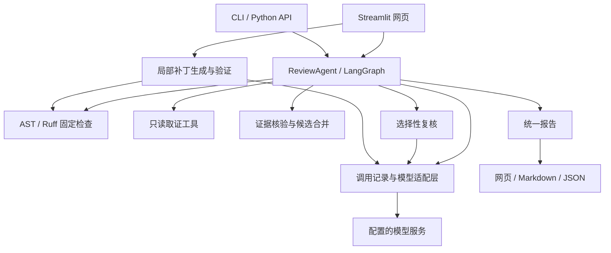
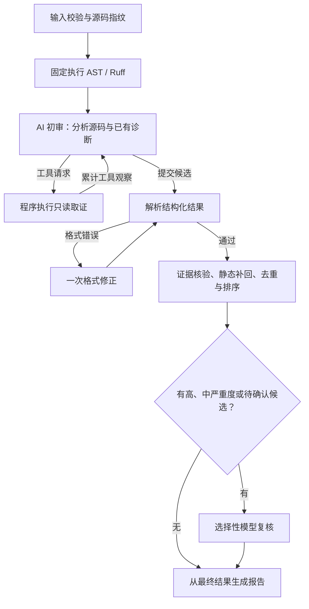
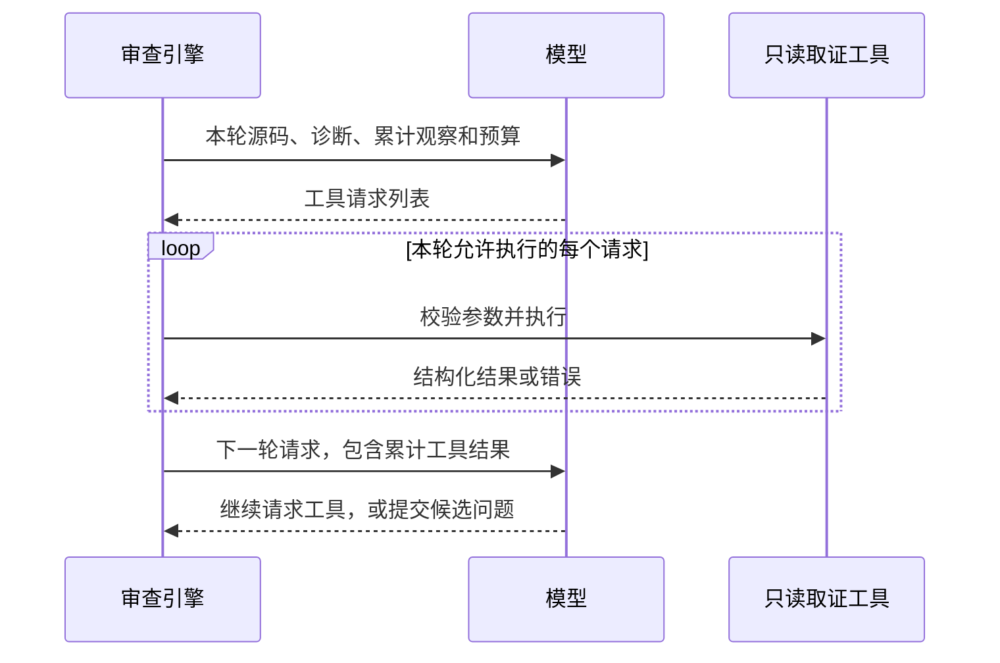
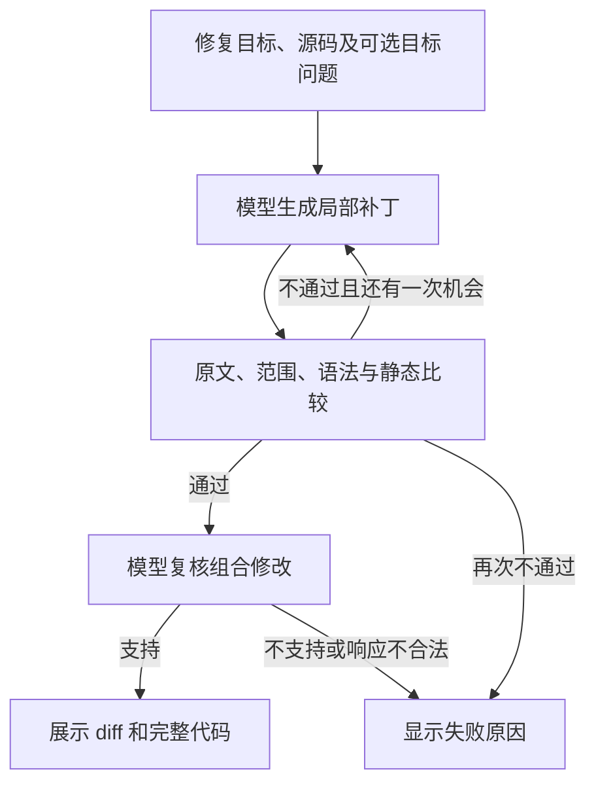
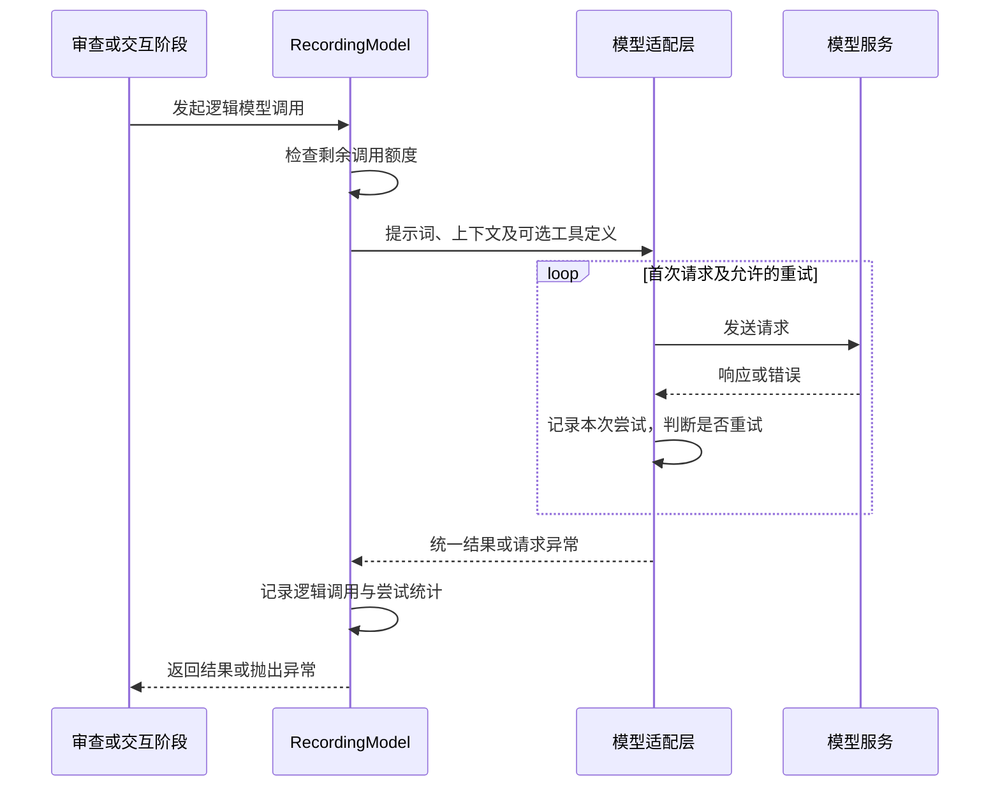

# TraceReview 设计说明

TraceReview 面向单个 Python 源码快照，结合确定性规则与模型分析输出可核对的审查报告。使用与启动方式见 [README.md](README.md)。

## 1. 设计目标与总体架构

系统围绕三个目标组织：用固定静态检查提供规则依据，用源码定位和模型复核整理候选，用统一报告连接网页、命令行及后续修复。

AST 与 Ruff 每次固定执行，避免基础检查依赖模型是否主动调用工具。模型负责结合控制流、数据流和功能约定分析问题；程序负责执行工具、验证结构与证据、合并结果和统计。独立复核采用同一配置模型的新请求与专门提示词。



统一核心使不同入口共享同一套核验、预算和报告语义。模型服务通过适配层接入，核心依赖统一调用接口；测试可以注入假模型及静态检查替身，分别验证流程编排与检查行为。

| 模块 | 职责 |
| --- | --- |
| `app.py` | 网页输入、进度、会话、报告、追问和补丁预览 |
| `cli.py`、`__main__.py` | 读取文件、命令行审查和报告导出 |
| `graph.py`、`state.py` | LangGraph 节点、工具循环和审查状态 |
| `ast_rules.py`、`ruff_adapter.py` | AST 规则与隔离配置的 Ruff 检查 |
| `tools.py` | 源码范围、符号上下文、静态诊断三个只读工具 |
| `source.py`、`verification.py` | 源码行处理、输入校验、证据定位及结果合并 |
| `llm.py`、`prompts.py`、`config.py` | 模型请求、阶段提示词、调用记录与预算 |
| `reflection.py`、`patches.py` | 问题复核、补丁生成和校验 |
| `models.py`、`reporting.py`、`ui_text.py` | 数据协议、报告导出和展示标签 |

## 2. 入口与完整审查流程

网页、CLI 和 Python API 都调用 `ReviewAgent.review()`。核心引擎接收源码字符串，不读取整个仓库；每次审查重建调用统计和工具观察。

| 入口 | 输入与输出职责 |
| --- | --- |
| Streamlit 网页 | 从示例、上传或编辑区取得源码，展示进度、报告及后续交互 |
| CLI | 读取 UTF-8 文件，调用核心，向终端或指定文件导出 Markdown / JSON |
| Python API | 调用方传入源码、文件名和审查重点，获得 `ReviewReport` |

网页通过单工作线程运行审查，主线程从队列读取阶段回调并刷新进度。核心用 `ReviewState` 在节点之间传递源码、静态诊断、累计工具观察、候选和报告；模型调用记录按本次审查保存。下图展示主流程，后续章节依次展开各阶段。



| 图节点 | 主要行为 |
| --- | --- |
| `validate_input` | 校验文件名、源码和审查重点，统一换行并计算 SHA-256 |
| `static_analysis` | 顺序执行 AST、Ruff，保存诊断和工具状态 |
| `agent_reasoning` | 构造初审请求，接收工具请求或最终候选 |
| `tool_execution` | 执行本轮工具，累计观察并返回初审 |
| `parse_draft` | 按 Pydantic 协议解析候选，必要时请求一次格式修正 |
| `reconcile_and_ground` | 定位证据、核对规则引用、补回静态结果并合并 |
| `reflection` | 复核指定候选，应用裁决或在失败时降级 |
| `finalize_report` | 按最终状态分组，重建摘要和运行统计 |

## 3. 输入校验与源码快照

处理对象为单个 UTF-8 `.py` 文件，最多 2000 行、102400 字节。输入校验拒绝不符合扩展名要求、全空白或包含 NUL 的内容，并约束文件名和审查重点的长度。网页上传、编辑区、CLI 与核心使用同一输入约束。

程序先检查原始源码的 UTF-8 字节数，再将 CRLF、CR 统一为 LF，计算源码行数及 SHA-256 指纹。后续静态分析、模型上下文、证据核验和补丁均使用这一规范源码，保持行号与证据一致。

报告以源码指纹关联本次输入，网页同时比较文件名。输入变化后仍可查看旧报告，但追问与旧补丁预览暂停，重新审查后建立新快照，避免将旧结论用于已改变的代码。

## 4. 固定静态分析

`static_analysis` 节点顺序执行 AST 与 Ruff，分别保存诊断和工具状态。两者每次审查固定运行：AST 表达项目自定义检查模式，Ruff 补充通用 Python 诊断，结果共同作为模型初审与候选合并的依据。

### 4.1 AST 规则

`analyze_ast()` 先解析语法树；语法解析失败时生成 AST001，否则遍历相关表达式、语句和作用域，提取规则编号、源码位置、连续证据及修复建议。

| AST 规则 | 检查内容 | 默认严重度 | 初始确认状态 |
| --- | --- | --- | --- |
| AST001 | Python 语法解析失败 | 高 | 规则已确认 |
| AST101 | 默认参数使用可变容器字面量或无参数的 `list/dict/set` 调用 | 中 | 规则已确认 |
| AST102 | 不指定异常类型的裸 `except` | 中 | 规则已确认 |
| AST103 | `except` 主体仅有 `pass` | 中 | 规则已确认 |
| AST104 | `/`、`//` 的右侧为零常量；`%` 还要求左侧为数值字面量 | 高 | 规则已确认 |
| AST105 | `finally` 中存在当前作用域的 `return` | 中 | 规则已确认 |
| AST106 | 直接按名称调用 `eval/exec` | 中 | 需要人工确认 |
| AST107 | 简单赋值或独立表达式调用 `open()`，当前作用域未见相应关闭 | 中 | 需要人工确认 |
| AST108 | `subprocess` 属性调用显式使用 `shell=True` | 中 | 需要人工确认 |
| AST109 | 直接捕获 `Exception` | 低 | 规则已确认 |

规则确认表示源码符合检查模式；具体影响仍结合触发条件解释。资源规则按作用域内的变量名称观察关闭操作，安全规则提供需要上下文判断的调用信号，因此先保留为待确认。

### 4.2 Ruff 检查

`run_ruff()` 优先使用 PATH 中的 Ruff，否则使用当前 Python 环境中的模块。源码通过标准输入提交，使用以下命令隔离外部配置并取得结构化诊断：

```text
ruff check --isolated --no-cache --select F,E9 --output-format json --stdin-filename <filename> -
```

F 系列覆盖未定义名称、未使用导入等问题；E9 系列及 `invalid-syntax` 提供语法诊断。适配层将规则、行列位置、诊断说明和建议转换为统一 `StaticFinding`：语法错误及 F821/F822/F823 默认为高严重度，F401/F541/F841 为低，其余为中。

子进程使用 `shell=False`，默认超时 11 秒；退出码 0、1 正常解析，其他退出码、不可用、超时或解析失败保存为工具状态。语法错误保留诊断并继续后续审查。固定 AST 与 Ruff 的执行不计入模型追加取证次数。

## 5. 模型初审与只读取证

### 5.1 初审上下文与工具循环

初审提示词引导模型理解输入输出与功能约定，沿控制流、数据流检查边界、异常、资源和安全，并核对注释与实现。源码表示实际行为，注释提供意图线索，审查重点可以补充明确需求。

每轮初审发送完整带行号源码、文件名、审查重点、全部静态结果、累计工具观察、剩余预算及候选 schema。工具用于补充结构化证据；模型无需为每条问题重复读取已有源码。存在取证依赖时，分轮请求工具。

程序以 system/human 请求传递上述载荷，不维护完整的跨轮 assistant/tool 消息历史。初审格式修正发送错误摘要、上次输出和 schema；问题复核及其格式修正发送完整源码与指定候选。



一轮初审对应一次逻辑模型调用，可以提出多个工具请求；程序依次执行工具，结果进入下一轮模型上下文。工具执行单独计数，不消耗模型调用次数。模型提交候选后结束初审，再进入程序核验与选择性复核。

初审使用有界循环。达到轮数上限或预留调用额度时关闭工具，要求提交候选，为后续格式修正与复核留出预算；具体上限见第 9 节。

### 5.2 只读取证工具

固定检查已经产生基础诊断；取证工具供模型按需查询源码结构和已有结果，不重新执行完整静态检查。

| 工具 | 输入 | 返回信息 |
| --- | --- | --- |
| `read_source_range` | 起止行号 | 最多 120 行带行号源码 |
| `get_symbol_context` | 符号名、可选上下文起始行 | 唯一定义、签名、附近源码和名称匹配的调用位置 |
| `get_static_findings` | 可选严重度、规则号、offset | 已有诊断的筛选结果，每页最多 30 条 |

工具只读当前内存源码和已完成诊断，不接受任意文件路径。参数通过 Pydantic 校验，同次审查中重复请求返回结构化错误。每条工具结果的完整 JSON 最多 6000 字符；截断时返回标记和继续位置，模型可在剩余轮次内分页读取。

符号工具最多返回 20 个调用位置，签名最多 500 字符；调用位置按名称匹配。每轮初审仍发送完整源码和累计观察，因此工具输出上限不等于总上下文上限。

## 6. 候选核验、合并与复核

模型提交 `findings` 列表，每条候选包含标题、严重度、类别、行段、连续源码证据、触发条件、解释、建议及可选规则号。Pydantic 限制字段、枚举和长度；来源、确认状态和问题编号由程序生成。

证据先在申报行段内精确定位；全文唯一时可重定位，缺失或无法消歧则拒绝。仅引用注释或独立文档字符串的候选被排除，注释与实现的矛盾可以通过包含两者的连续证据表达。规则引用按本次真实诊断的规则和位置核对，故障机制由模型分析与复核判断。

程序保留工具原始静态诊断，补回模型未写入的结果，再合并模型候选。问题编号结合来源、规则、位置及诊断内容生成，供复核、报告记录和网页操作引用。候选按严重度、静态优先、行号与规则排序，复核前最多保留 30 条；数量裁剪写入校验记录。

静态补回使固定检查的覆盖不依赖模型是否在最终文本中复述诊断。严重度描述影响，确认状态描述证据支持程度，两者分别保存，避免把证据不足直接等同于影响较低。只复核高、中严重度或待确认的问题，以集中使用模型额度。

| 来源与初始状态 | 支持 | 不确定 | 不支持 |
| --- | --- | --- | --- |
| AI 候选／待确认 | AI 复核通过 | 需要人工确认 | 排除 |
| 静态诊断／规则已确认 | 保持规则确认 | 保持规则确认 | 保留信号，转为需要人工确认 |
| 静态诊断／待确认 | AI 复核通过 | 需要人工确认 | 保留为需要人工确认 |

复核必须完整且唯一地覆盖目标 ID，可调整标题、严重度、触发条件、解释和建议，不得新增候选或改变证据、位置、来源。格式可修正一次；整体失败时保留静态发现，AI 候选仍待确认，并记录限制。

## 7. 报告与网页展示

`ReviewReport` 保存文件名、源码指纹、审查重点、模型、最终问题、校验记录、工具状态、执行事件和用量。摘要从最终结果生成；严重度数量覆盖已确认与待确认问题。

```text
ReviewReport
├── schema_version、filename、source_hash、focus、model
├── summary：已确认数、待确认数、严重度分布与摘要
├── findings / pending_findings：按确认状态拆分的问题
│   └── ID、来源、状态、严重度、类别、行段、证据、触发、解释、建议
├── validation_records：证据核验、合并与复核记录
├── tool_statuses、limitations、events：检查状态、限制与阶段事件
└── usage：总耗时、阶段耗时、调用记录、预算及已知 token 用量
```

网页与 Markdown 按“已确认问题”“需要人工确认”分组，再按 AST、Ruff 和 AI 来源展示。JSON 保留结构化枚举。报告使用格式版本 1.1，同时支持读取 1.0；旧报告缺少的统计字段采用兼容默认值。

## 8. 追问与局部修复

### 8.1 会话与追问

网页会话保存源码、报告、最近 8 条聊天消息、补丁及最近交互统计。源码或文件名改变后，追问与旧补丁预览暂停；重新审查先清空旧结果。普通追问发送源码、最终报告、近期聊天和当前问题，调用一次模型并解析 `answer`。

### 8.2 补丁生成与验证



每次补丁包含 1～3 处不重叠修改。程序校验完整原始行段，以倒序切片组合代码，再进行语法解析和 Ruff 前后比较，禁止新增 Ruff 诊断。有具体 AST/Ruff 目标时，还检查目标诊断是否消失。程序不运行行为测试，也不全面比较新增 AST 规则问题。

生成或程序校验失败允许基于同一原始源码、携带上次错误再生成一次；校验通过后进行一次模型复核，只有支持时展示正文。通常需要两次模型调用，生成修正后最多三次。

报告中的修复按钮传入单条问题作为结构化目标，提示词要求围绕目标做最小必要修改；聊天按“修复”“补丁”“fix”“patch”关键词分流，修复请求使用当前文字作为目标。每次生成使用当前输入源码，页面保存最新补丁，结果在内存中供复制，不自动写回编辑区或叠加到下一次修复。用户采用修复代码后重新审查，即建立新的报告快照。追问与修复均建立独立调用统计，在网页单独显示。

## 9. 模型适配、调用记录与预算

### 9.1 模型请求与重试

初审、格式修正、问题复核、追问和补丁使用统一的模型调用接口。`RecordingModel` 管理本次操作的逻辑调用额度，`DeepSeekModel` 负责通过 `ChatOpenAI` 发送请求、转换文本与工具请求，并记录每次 HTTP 尝试。



SDK 内置重试关闭，由适配层统一控制。超时、限流和部分服务错误允许重试；明确的凭证或请求错误直接失败。逻辑调用对应阶段的一次请求动作，HTTP 尝试对应服务访问，工具执行对应本地取证，三者分别计数。

### 9.2 调用预算

有界循环允许模型补充证据，同时控制成本并保证流程结束。初审最后一轮关闭工具，要求提交候选；格式修正和复核使用预留额度。

| 项目 | 上限或规则 |
| --- | --- |
| 初审 | 最多 5 轮；调用前剩余额度不超过 4 次时也要求收尾 |
| 追加取证 | 前四轮每轮最多 5 次，共最多 20 次 |
| 初审格式修正 | 最多 1 次 |
| 复核及其格式修正 | 合计最多 2 次，无目标则跳过 |
| 一次审查的逻辑模型调用 | 最多 8 次，失败调用计数 |
| 服务请求 | 默认超时配置 40 秒，可重试的失败最多重试 2 次 |
| 单次模型输出 | 最多 4096 tokens |

`RecordingModel` 在调用前检查预算，在成功或失败后记录调用。一次逻辑调用内部可能有多个 HTTP 尝试；模型调用、HTTP 尝试和工具执行分别计数。连接测试、追问和补丁操作不并入已完成报告的统计。40 秒是单次请求配置，审查没有统一总时限。

### 9.3 运行统计

阶段计时包装器记录节点耗时，模型适配层记录每次逻辑调用和 HTTP 尝试，包括可取得的 token 用量、结束原因与失败状态。缺失用量显示为不可用。报告保存源码证据，不保存完整提示词和全部工具观察。

节点计时覆盖该阶段的程序处理与模型等待，逐次调用计时描述模型访问，两者存在包含关系。token 只累计服务返回的已知值，部分缺失时合计仅代表可取得的用量。报告统计在审查完成时确定；后续追问和补丁使用新的调用记录，在网页显示最近交互统计。

## 10. 失败处理与测试

| 情况 | 处理 |
| --- | --- |
| 输入不合法、初审请求失败、候选格式两次失败 | 审查失败，入口显示错误 |
| 源码语法错误 | 保存语法诊断，继续审查 |
| Ruff 不可用、超时或异常 | 保存工具状态和限制，继续审查 |
| 工具参数错误、重复请求或未知工具 | 返回结构化观察，交给下一轮初审 |
| 强制收尾时仍请求工具 | 停止取证，以空模型候选继续静态合并并记录原因 |
| 复核整体失败 | 静态发现保留，AI 候选待确认 |
| 补丁校验或复核未通过 | 显示原因，隐藏补丁正文 |

自动化测试通过假模型、模拟 HTTP、真实静态工具和 Streamlit AppTest 验证输入、工具循环、预算、证据核验、复核、补丁、报告及入口交互。运行方式为 `python -m pytest`。

当前范围为单文件静态审查，跨文件关系、外部业务事实和行为验证仍需项目上下文。在线模型的准确率与服务表现应通过实际任务评估。
