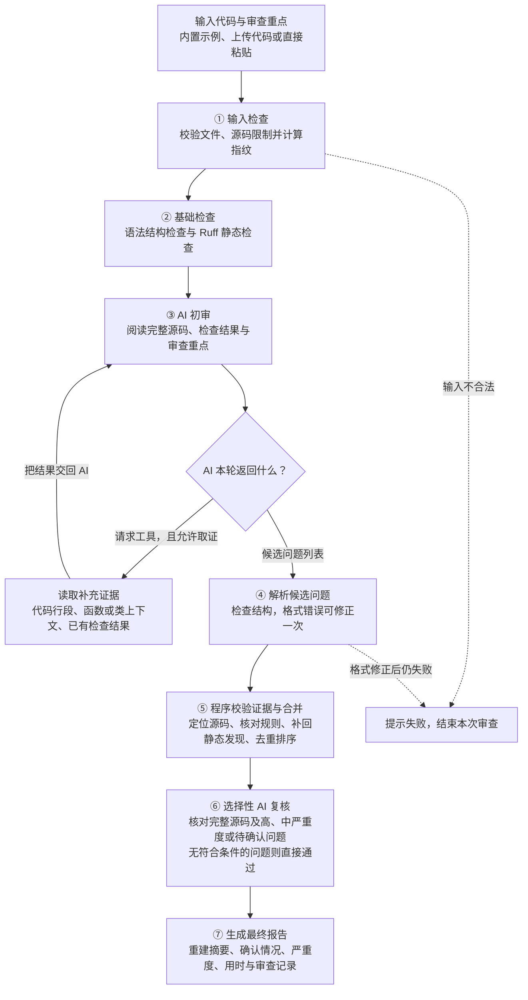
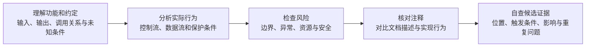

# TraceReview 设计说明

## 审查主流程：程序实际执行哪些步骤

先运行固定检查，再由 AI 分析；AI 可以请求补充证据。候选问题必须经过程序校验，必要时再由 AI 独立复核，最后生成报告。

实线是正常执行路径，虚线是失败退出路径。补充取证只能回到“AI 初审”，不会直接跳到证据校验。

| 步骤 | 由谁完成 | 实际作用 |
|---|---|---|
| 输入检查 | 程序 | 统一换行，拒绝非 Python 文件、空内容、空字节及超限源码，计算完整源码指纹 |
| 基础检查 | 程序和静态工具 | 每次固定执行 AST 与 Ruff，不让 AI 决定是否检查 |
| AI 初审 | 模型 | 阅读完整带行号源码、静态诊断、审查重点和已有取证结果，选择取证或提交候选 |
| 补充取证 | 程序执行 AI 的请求 | 只读取当前内存源码和本次诊断，不运行用户代码、不读取任意路径 |
| 解析与证据校验 | 程序 | 检查候选格式、源码引用和规则关联，补回模型漏写的静态发现，最多保留 30 条 |
| 选择性复核 | 同一模型的独立请求 | 支持、保留为待确认或排除候选；不得新增问题或修改证据位置 |
| 生成报告 | 程序 | 从最终保留问题重建统计，不沿用初审摘要；页面显示中文确认情况及秒单位用时 |

当前源码限制为 1000 行、UTF-8 编码后 2 MiB。AI 初审最多 3 轮，第 3 轮停止提供工具并要求提交候选；每轮最多执行 5 次追加工具调用，超出部分返回上限提示并记录覆盖限制。格式修正与独立复核请求不计入初审轮次。如果模型在强制结束时仍请求工具，程序停止取证、按空模型候选继续，并在报告中记录覆盖限制；真实静态发现仍会补回。

单次 HTTP 模型请求超时为 40 秒，单次输出上限为 4096 tokens，符合重试条件的失败最多重试 2 次。单次超时不是整个审查的总用时上限。

## AI 初审如何阅读代码：提示词规定的检查顺序

下面是“③ AI 初审”内部遵循的方法，不是五个独立的程序节点，也不代表五次模型调用。

源码反映实际实现，注释与文档字符串提供意图线索，不能自动当作正确需求。“审查重点”调整关注程度，也可提供明确功能约定，但不能代替基本检查或成为存在缺陷的证据。

注释与实现矛盾时，应同时引用两者，说明具体差异；缺少明确需求时，不擅自认定必须改代码。当前只支持一个连续源码证据片段，注释与实现之间的代码不能省略。提示词规定检查顺序，但程序尚未逐项记录或验证模型的检查覆盖。

## 失败与降级：报告是否还能生成

| 情况 | 当前处理 |
|---|---|
| 输入不合法、初审请求最终失败、候选格式两次失败 | 本次审查失败，页面显示错误 |
| Ruff 不可用、超时或异常 | 记录工具状态和覆盖限制，后续审查继续；不能解释为没有问题 |
| 追加工具参数非法、未知工具或重复调用 | 返回结构化错误，让 AI 基于已有信息继续 |
| 源码证据不存在、位置歧义或只有注释 | 排除对应模型候选，保留校验记录 |
| 复核不支持某条纯模型候选 | 排除该候选；不会因此删除真实静态发现 |
| 独立复核整体失败 | 保留静态发现，模型意见降为待确认，并记录覆盖限制 |

`ReviewState` 保存源码、工具结果、候选、审查记录与统计，在上述程序节点之间传递。追问和生成修复是报告生成后的用户操作，不属于这张初次审查主流程图。

## 静态事实与自主取证

AST 规则覆盖语法、可变默认参数、异常、字面量除零、`finally return`、`eval/exec`、文件句柄、`shell=True` 和宽泛 `Exception`。Ruff 使用固定 F/E9 参数。两者失败都会产生状态，不被解释为“无问题”。模型可读取有界行段、唯一符号上下文或查询已存静态结果；工具不接受任意路径，重复请求和非法参数返回结构化错误。

## 数据模型与问题确认状态

Pydantic 模型默认 `extra="forbid"`，枚举由 `Literal` 限制。严重度、来源和确认状态是独立维度：

- **规则检查已确认**：本次 AST/Ruff 中不需要额外上下文的规则诊断。
- **AI 复核通过**：通过原文定位且获得 AI 独立复核支持的问题，也包括经复核支持的上下文型静态规则发现。
- **需要人工确认**：依赖缺失上下文、尚未获得复核支持的模型意见、上下文型静态规则发现，或被 AI 明确否定但仍保留的静态规则信号。

严重度表示问题成立后的影响，待确认或复核服务失败不会自动降低严重度；AI 可根据实际影响修正等级。

以上是每条问题的确认状态，与 Agent 节点间传递数据的 `ReviewState` 不同。前两种归入报告的“已确认问题”，第三种归入“需要人工确认”。

## 合并、落地与复核

`reconcile_and_ground` 验证 evidence 是源码的连续原文。先在声称行段内匹配；全文唯一时可重定位，多处歧义则拒绝。仅在注释或独立文档字符串中的证据被拒绝。`rule_id` 必须与本次真实诊断的规则与位置重叠，否则去除背书。模型漏写的静态诊断由程序补回，然后精确去重、排序并最多保留 30 条。

只复核高／中严重度或需要人工确认的候选，复核请求同时提供完整源码。复核必须完整且唯一地覆盖候选 ID，不得新增问题或更换证据。格式可修复一次。纯模型候选被否定时排除；静态规则发现被否定时保留规则信号，但转为“需要人工确认”。上下文型静态发现被复核支持时可标记为“AI 复核通过”。对于“规则检查已确认”的问题，AI 返回不确定时仍保留原状态。复核失败不删除真实静态发现，模型意见则改为“需要人工确认”，保留严重度。最终摘要从保留结果重建。

页面首先按“已确认问题”和“需要人工确认”分组，再按 AST、Ruff 和 AI 来源分组。顶部只统计两种确认状态和总用时；严重度仅在具体问题内以标签展示，避免把严重程度和确认程度混为同一组汇总指标。

## 会话、补丁与失效

Streamlit `session_state` 保存当前源码、文件名、报告、最近 8 条追问消息和未应用补丁。每次交互都对编辑区重算哈希；与报告不同时仍允许查看旧报告，但禁用追问和补丁。

补丁最多三个且不重叠。程序检查完整原始行段，再以倒序切片在内存中一次组合。组合后运行 `ast.parse`，并按（规则、符号、行、诊断）比较修复前后 Ruff，再进行独立模型复核。失败可修正一次，仍失败则隐藏补丁正文。

## 错误、重试与安全

408/429/500/502/503/504 和网络类错误最多重试两次，400/401/402/403/404 直接返回配置错误。不暴露远端响应正文或 Key。初审 JSON 可修复一次，再失败则整次失败。追加工具只读内存快照。用户源码从不被导入或执行。

## 功能演示与测试

本项目通过网页交互演示代码输入、在线 AI 审查、问题复核、报告展示、追问、局部修复和报告导出等功能。内置示例覆盖典型代码问题、依赖上下文的风险场景及具有保护措施的代码，可用于观察审查结果并核对源码证据。

自动化测试使用预设模型响应，检查工具调用、证据校验、问题合并、确认状态、异常处理、补丁验证及网页和命令行流程，不作为在线 AI 审查效果的评估依据。
