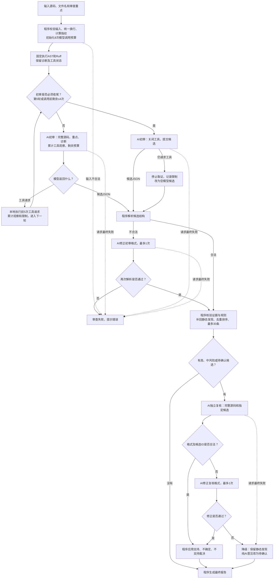
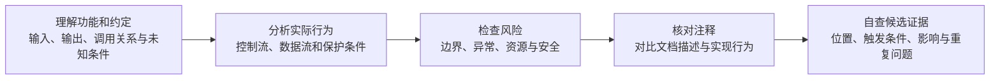
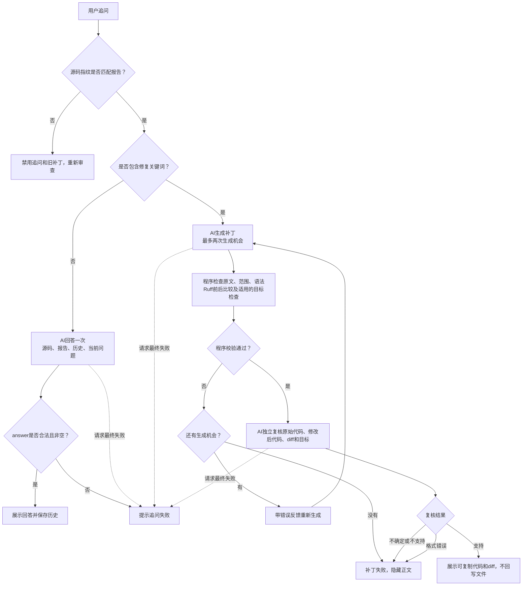
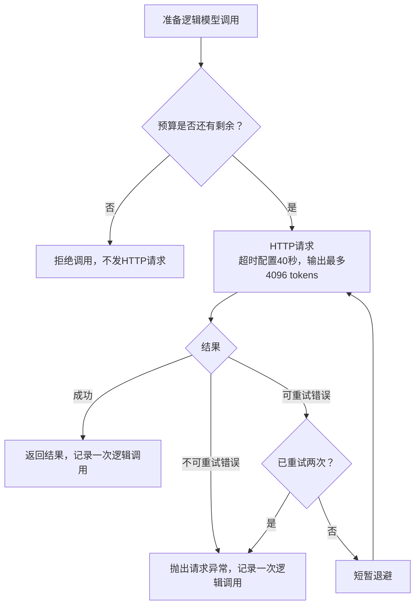

# TraceReview 设计说明

本文描述 `软件工程/code-review-agent/` 中的当前实现。使用、安装和演示入口见 [README.md](README.md)。流程图中的“AI”节点产生逻辑模型调用，工具节点在本地执行，其他节点由程序完成。

## 目标与模块职责

目标是在单文件、只读静态分析的范围内，将模型候选落到可核对的源码证据，并展示确认状态、覆盖限制和执行统计。系统不执行用户代码，不分析整个仓库，也不将模型裁决当作测试证明。

| 模块 | 职责 |
|---|---|
| `app.py` | 网页输入、进度、报告、追问、补丁预览和会话失效 |
| `review_agent/cli.py` | 命令行审查与 Markdown/JSON 导出 |
| `config.py` | 输入、调用、工具输出及服务参数的默认限制 |
| `graph.py`、`state.py` | LangGraph 节点、循环路由及本次审查状态 |
| `ast_rules.py`、`ruff_adapter.py` | 固定静态检查及工具状态 |
| `tools.py` | 三个只读取证工具、参数验证、重复检测与输出裁剪 |
| `llm.py`、`prompts.py` | 模型适配、调用预算、HTTP 重试、统计及阶段提示词 |
| `verification.py`、`reflection.py` | 证据核验、静态补回、去重与选择性 AI 复核 |
| `patches.py` | 内存补丁组合、程序校验与模型复核 |
| `models.py`、`reporting.py`、`ui_text.py` | 数据结构、报告导出及中文展示 |
| `tests/`、`scripts/package_submission.py` | 离线验证与按当前项目位置生成提交包 |

## 审查主流程：程序实际执行哪些步骤

先运行固定检查，再由 AI 分析；AI 可以请求补充证据。候选问题必须经过程序校验，必要时再由 AI 独立复核，最后生成报告。




实线展示正常路由和格式分支，虚线展示部分异常路由。补充取证只能回到初审，不会直接进入证据校验。复核修正请求失败与复核请求失败采用相同降级处理。初审任一轮直接提交候选后就退出初审循环。

| 步骤 | 由谁完成 | 实际作用 |
|---|---|---|
| 输入检查 | 程序 | 统一换行，拒绝非 Python 文件、空内容、空字节及超限源码，计算完整源码指纹 |
| 基础检查 | 程序和静态工具 | 每次固定执行 AST 与 Ruff，不让 AI 决定是否检查 |
| AI 初审 | 模型 | 阅读完整带行号源码、静态诊断、审查重点和已有取证结果，选择取证或提交候选 |
| 补充取证 | 程序执行 AI 的请求 | 只读取当前内存源码和本次诊断，不运行用户代码、不读取任意路径 |
| 解析与证据校验 | 程序 | 检查候选格式、源码引用和规则关联，补回模型漏写的静态发现，最多保留 30 条 |
| 选择性复核 | 同一模型的独立请求 | 支持、保留为待确认或排除候选；不得新增问题或修改证据位置 |
| 生成报告 | 程序 | 从最终保留问题重建统计，不沿用初审摘要；页面显示中文确认情况及秒单位用时 |

当前源码限制为 2000 行、UTF-8 编码后 100 KB（102400 字节，换行归一化前计量）。AI 初审最多 5 轮，第 5 轮停止提供工具并要求提交候选；每轮最多执行 5 次追加工具调用，超出部分返回上限提示并记录覆盖限制。格式修正与独立复核请求不计入初审轮次，但共同计入每次审查最多 8 次逻辑调用的硬预算；失败调用也计数，HTTP 重试另计。初审为收尾、格式修正和复核预留额度，前四轮最多执行 20 次工具。如果模型在强制结束时仍请求工具，程序停止取证、按空模型候选继续，并在报告中记录覆盖限制；真实静态发现仍会补回。

单次 HTTP 模型请求超时为 40 秒，单次输出上限为 4096 tokens，符合重试条件的失败最多重试 2 次。单次超时不是整个审查的总用时上限。

## AI 初审如何分析与传递上下文

下面概括初审提示词要求的分析方法，不是五个独立程序节点，也不代表五次模型调用；程序不保证模型严格按固定顺序完成每项检查。



源码反映实际实现，注释与文档字符串提供意图线索，不能自动当作正确需求。“审查重点”调整关注程度，也可提供明确功能约定，但不能代替基本检查或成为存在缺陷的证据。

注释与实现矛盾时，应同时引用两者，说明具体差异；缺少明确需求时，不擅自认定必须改代码。当前只支持一个连续源码证据片段，注释与实现之间的代码不能省略。提示词规定检查范围和方法，但程序尚未逐项记录或验证模型的检查覆盖。

模型不是在一次 API 请求内部直接执行工具：一次初审响应返回工具请求后，该次调用已经结束，程序执行工具，再通过下一次模型调用交回结果。一次响应可请求多个工具，有先后依赖的取证需要分轮进行。

每轮初审重新发送完整带行号源码、审查重点、全部静态结果、累计工具观察、剩余调用额度及候选结构要求。当前没有维护跨轮候选草稿，也没有把上一轮完整模型响应作为聊天历史传入；工具结果与工具请求 ID 对应，不与候选 ID 逐条绑定。第一轮可以直接提交候选，不要求每条候选都调用工具“求证”。返回空模型候选不代表文件正确，程序仍会补回真实静态发现。

初审格式修正请求仅发送错误输出（最多 8000 字符）、错误摘要和结构要求，不重新发送完整源码；复核格式修正则仍提供完整源码和指定候选。

## 调用口径与预算分配

| 计数 | 含义 | 不包含的内容 |
|---|---|---|
| `model_calls` | 一次 `invoke` 计一次，包括最终失败的调用 | 调用内部的额外 HTTP 重试、程序校验 |
| `http_attempts` | 实际服务请求尝试，包含失败和重试 | 本地工具执行 |
| `tool_calls` | 被选中并交给执行器的追加工具请求，包括返回错误的请求 | 固定 AST/Ruff、每轮超过5次而跳过的请求 |

一次初审请求两个工具，第二次初审提交候选，第三次请求完成复核：计 3 次模型调用、2 次补充取证；如果其中一次请求先失败后重试成功，HTTP 请求计 4 次。

```text
初审最多5次 + 初审格式修正最多1次 + 复核及其修正最多2次 = 最多8次
前四轮初审 × 每轮最多5次追加工具 = 最多20次追加取证
```

`RecordingModel` 在每次调用前检查剩余额度，调用结束或失败均记录一次；已用满额度时阻止下一次服务调用。初审调用前若剩余不超过4次，就关闭工具，为本次候选提交、一次初审格式修正及两次复核请求预留空间。次数是上限，简单输入可直接结束。

初审、普通追问、补丁操作分别建立独立预算，不是整个会话合计8次。连接测试是独立服务检查，不计入审查报告。报告统计仅记录生成该报告的一次审查。

## 失败与降级：报告是否还能生成

| 情况 | 当前处理 |
|---|---|
| 输入不合法、初审请求最终失败、候选格式两次失败 | 本次审查失败，页面显示错误 |
| Ruff 不可用、超时或异常 | 记录工具状态和覆盖限制，后续审查继续；不能解释为没有问题 |
| 追加工具参数非法、未知工具或重复调用 | 返回结构化错误，让 AI 基于已有信息继续 |
| 源码证据不存在、位置歧义或只有注释 | 排除对应模型候选，保留校验记录 |
| 复核不支持某条纯模型候选 | 排除该候选；不会因此删除真实静态发现 |
| 独立复核整体失败 | 保留静态发现，模型意见降为待确认，并记录覆盖限制 |

`ReviewState` 保存源码、工具结果、候选、审查记录与统计，在上述程序节点之间传递。追问和生成修复是报告生成后的用户操作，不属于这张初次审查主流程图。每次审查、追问或补丁操作独立受 8 次逻辑调用预算保护；普通追问一次回答。补丁调用上限和解析异常分支见下文；这些后续操作不追加到初审报告统计。

## 静态事实与自主取证

AST 规则覆盖语法、可变默认参数、异常、字面量除零、`finally return`、`eval/exec`、文件句柄、`shell=True` 和宽泛 `Exception`。Ruff 使用固定 F/E9 参数。两者失败都会产生状态，不被解释为“无问题”。模型可读取有界行段、唯一符号上下文或查询已存静态结果；工具不接受任意路径，重复请求和非法参数返回结构化错误。所有工具成功与错误结果的最终 JSON 最多 6000 字符，按完整源码行或诊断条目裁剪，保留结构及截断标志、继续位置。符号上下文可通过 context_start_line 分页，静态诊断可通过 offset 分页；超长单条标记 partial_item，未返回部分不能当作不存在。符号的调用位置仅按名称匹配，并非精确调用图。工具截断记入报告限制；执行事件列出工具名称、返回数据或错误码及截断情况，不保存全部原始工具输出。

### 工具协议和分页

这些工具是项目自定义的程序函数，不调用模型。相同源码、已有诊断和参数在执行正常时产生确定性数据；同一次审查内完全相同的工具与参数再次请求会返回 `duplicate_call`，错误请求也参与重复检测。

| 工具 | 参数 | 返回信息与限制 |
|---|---|---|
| `read_source_range` | `start_line`、`end_line` | 带行号源码，一次最多120行，范围必须有效；截断后用 `next_start_line` 作为下一次 `start_line` |
| `get_symbol_context` | `symbol_name`、可选 `context_start_line` | 唯一函数或类定义、签名摘要、附近源码、最多20个名称匹配调用位置；每页上下文最多120行，继续时把 `next_start_line` 传为 `context_start_line` |
| `get_static_findings` | 可选 `severity`、`rule_id`、`offset` | 本次已有诊断的总数与当前页，一页最多30条；继续时把 `next_offset` 传为 `offset`，不重新运行AST/Ruff |

最终 JSON 字符限制按 `json.dumps(..., ensure_ascii=False)` 计量，包含外层结构；字符数不是 UTF-8 字节数或 token 数。裁剪优先保留完整源码行、完整诊断和继续位置。单条诊断或源码行过长时可能返回部分字符串，或空诊断页，并标记 `partial_item`；继续位置可能不前进，不能承诺分页一定取回完整单条内容。此时应缩小查询或明确证据缺口，不得循环重试同一参数。

签名摘要最多500字符，调用位置最多20处；分别通过 `signature_truncated` 和 `call_lines_truncated` 标记省略，并返回 `call_count`。调用位置本身没有分页。工具主要组织已有信息：第一轮已给出完整源码和静态诊断；工具不补充跨文件、业务需求或运行时证据。

## 数据模型与问题确认状态

Pydantic 模型默认 `extra="forbid"`，枚举由 `Literal` 限制。严重度、来源和确认状态是独立维度：

- **规则检查已确认**：本次 AST/Ruff 中不需要额外上下文的规则诊断。
- **AI 复核通过**：通过原文定位且获得 AI 独立复核支持的问题，也包括经复核支持的上下文型静态规则发现。
- **需要人工确认**：依赖缺失上下文、尚未获得复核支持的模型意见、上下文型静态规则发现，或被 AI 明确否定但仍保留的静态规则信号。

严重度表示问题成立后的影响，待确认或复核服务失败不会自动降低严重度；AI 可根据实际影响修正等级。

以上是每条问题的确认状态，与 Agent 节点间传递数据的 `ReviewState` 不同。前两种归入报告的“已确认问题”，第三种归入“需要人工确认”。

## 合并、落地与复核

`reconcile_and_ground` 验证 evidence 是源码的连续原文。先在声称行段内匹配；全文唯一时可重定位，多处歧义则拒绝。仅在注释或独立文档字符串中的证据被拒绝。`rule_id` 必须与本次真实诊断的规则与位置重叠，否则去除背书。模型漏写的静态诊断由程序补回，然后精确去重、排序并最多保留 30 条。

只复核高／中严重度或需要人工确认的候选，复核请求同时提供完整源码。复核必须完整且唯一地覆盖候选 ID，不得新增问题或更换证据。格式可修复一次。纯模型候选被否定时排除；静态规则发现被否定时保留规则信号，但转为“需要人工确认”。上下文型静态发现被复核支持时可标记为“AI 复核通过”。对于“规则检查已确认”的问题，AI 返回不确定时仍保留原状态。复核失败不删除真实静态发现，模型意见则改为“需要人工确认”，保留严重度。最终摘要从保留结果重建。

网页和Markdown逐项展示确认情况；复核服务失败时保留的审查说明也会显示。页面首先按“已确认问题”和“需要人工确认”分组，再按 AST、Ruff 和 AI 来源分组。顶部只统计两种确认状态和总用时；严重度仅在具体问题内以标签展示，避免把严重程度和确认程度混为同一组汇总指标。

## 会话、补丁与失效

Streamlit `session_state` 保存当前源码、文件名、报告、最近 8 条追问消息、未应用补丁及最近一次后续交互的调用统计。每次交互都对编辑区重算哈希，同时核对文件名；与报告不同时仍允许查看旧报告，但禁用追问和补丁。重新审查前清除旧报告、对话、补丁和后续交互统计，避免请求失败后仍展示旧结果。修复按钮在缺少Key时禁用，补丁服务异常在页面内显示错误，不中断整页。

普通追问输入为完整源码、最终报告、最近最多8条历史消息及当前问题，仅调用模型一次并解析非空 `answer`。不提供取证工具、不做独立复核、不更新正式报告；格式错误不会另调模型修正。历史保留条数包含用户与助手消息，不代表内部模型轮次。

页面用关键词“修复”“补丁”“fix”“patch”分流补丁请求，不是模型意图分类。聊天修复只传源码、当前问题和文件名，不传追问历史、完整报告或结构化目标；用户应在当前修复请求中明确目标及预期行为。报告中每条问题的“生成修复”按钮会传入对应的结构化 `target`，供目标规则校验和模型生成使用。



补丁最多三处且不重叠。程序检查完整原始行段，再以倒序切片在内存中组合。组合后运行 `ast.parse`，并按（规则、符号、映射后的行号、诊断）比较修复前后 Ruff。若调用者提供结构化 `target`，还会核对目标 AST/Ruff 诊断是否消失；报告问题的修复按钮提供此参数，聊天修复未提供。程序校验通过后才进行独立模型复核。

生成格式或程序校验失败时允许第二次生成；独立复核仅在程序校验通过后调用一次。复核使用严格的 `PatchReviewResponse`，必须包含合法裁决及非空长度的字符串说明。解析错误、缺字段、非法裁决、`uncertain` 或 `rejected` 均返回补丁失败并隐藏正文，不会回到生成循环。成功一般为2次调用，生成修正后成功最多3次；没有专门的补丁复核格式修正调用。

普通追问使用 `FollowupResponse` 校验非空字符串 `answer`；`null`、数字、对象和纯空白不能被强制转成文字后当作成功。最近一次追问或修复的逻辑调用、服务请求及阶段记录在会话中，网页显示独立计数，审查报告不包含这些后续操作。

## 错误、重试与安全

408/429/500/502/503/504 和网络类错误最多重试两次，400/401/402/403/404 直接返回配置错误。不暴露远端响应正文或 Key。初审 JSON 可修复一次，再失败则整次失败。追加工具只读内存快照。用户源码从不被导入或执行。

### 单次模型调用内的服务请求



HTTP 重试由适配层完成，库内重试关闭，避免双重重试；重试仍属于同一次逻辑调用。JSON 格式修正发生在收到响应后，属于新的逻辑调用。最多8次审查调用，每次最多3次HTTP尝试，理论上最多24次HTTP尝试；失败可能提前终止流程。

## 报告内容、统计范围与解释边界

| 内容 | 网页 | Markdown导出 | JSON导出 |
|---|---|---|---|
| 最终问题及确认情况 | 分组展示 | 分组展示 | `findings`、`pending_findings` |
| 工具状态、校验记录和限制 | 展示 | 展示 | 对应结构化字段 |
| 阶段执行事件 | 执行轨迹 | 执行轨迹 | `events` |
| 阶段用时与调用统计 | 阶段表、逐次调用表、预算及初审结束原因 | 阶段表、逐次调用表、预算及初审结束原因 | `usage`及逐次调用、HTTP尝试 |
| 后续追问与补丁 | 会话中展示内容及独立调用计数 | 不包含 | 不包含 |

报告记录文件、归一化源码指纹、审查重点、模型名及数据格式版本。当前输出版本为1.1，数据模型仍支持读取1.0，网页会迁移代码热重载前保留的旧实例，并对旧报告的默认统计值给出提示；`usage`新增 `model_call_limit`、`plan_rounds`、`plan_round_limit`、`tool_call_limit` 与 `initial_stop_reason`，旧报告缺失字段可用默认值载入，但不能据此恢复旧运行的真实轮数或结束原因。最终摘要由程序从保留的问题重建，`summary.high/medium/low` 包含已确认与待确认问题，不能当作只统计已确认缺陷。复核失败及工具截断写入 `limitations`，超过30条候选的裁剪写入校验记录。

调用统计区分 `agent_reasoning`、`draft_repair`、`reflection`、`reflection_repair`；后续操作使用 `followup`、`patch_generation`、`patch_review`。状态“完成”表示模型请求完成，不代表JSON或业务校验通过；格式错误可由后续修正阶段体现。每次记录用时、HTTP尝试数、输入/输出token、答案字符数、可用的推理token、结束原因和失败标记。没有待复核候选时，执行事件明确写“无需独立复核”，不暗示已调用AI。服务未返回的统计为 `None`，Markdown显示“不可用”；聚合token只能覆盖服务实际返回用量的尝试，失败请求的未知费用无法据此还原。记录推理token数量不代表保存了内部思考内容。

报告不保存完整源码、全部工具观察或模型提示词，不是完整重放日志。最终报告节点返回前，由计时包装器补齐 `finalize_report` 阶段用时、事件耗时和总用时，导出与网页使用同一报告对象。报告在审查完成后一次展示，固定检查结果尚未提前展示。

“未保留问题”不证明代码正确；单条工具输出有界不等于总上下文有界，每轮完整源码、静态结果和累计观察仍会增长。当前没有累计上下文压缩、精确调用图、跨文件分析或程序验证的逐项检查覆盖。100 KB是应用接收上限，不是模型服务能完整处理的保证。

## 功能演示与测试

本项目通过网页交互演示代码输入、在线 AI 审查、问题复核、报告展示、追问、局部修复和报告导出等功能。内置示例覆盖典型代码问题、依赖上下文的风险场景及具有保护措施的代码，可用于观察审查结果并核对源码证据。

自动化测试使用预设模型响应和模拟HTTP，检查工具调用、证据校验、问题合并、确认状态、异常处理、补丁验证及网页和命令行流程。预算测试覆盖8次调用及禁止第9次、失败调用计数、四轮20次取证、100 KB/2000行输入边界、UTF-8字节和换行计量、工具输出长度、截断记录及分页。

这些测试验证程序行为，不评估在线 AI 审查效果。尚无基于真实模型的误报率、漏报率或3轮与5轮效果对比，不能把调用上限增加描述为已证明的质量提升。演示视频应以当前页面和预算说明为准，旧视频不是新行为的验证证据。

在当前项目根目录运行 `python -m pytest`，或使用 `.venv/bin/python -m pytest`。网页启动命令为 `python -m streamlit run app.py`；未激活环境时用 `.venv/bin/python -m streamlit run app.py`。当前提交方式是直接上传项目文件到仓库根目录，不生成压缩包；打包脚本仅作为可选辅助工具保留。

### 本次全面核对的验证范围

| 范围 | 验证内容 |
|---|---|
| 输入 | 100 KB/2000行边界、UTF-8、换行归一化前字节计量、CLI不提前转换换行 |
| 模型适配与预算 | 最长8次逻辑调用＋24次模拟HTTP尝试、前四轮工具开放及第五轮关闭、失败调用和格式修正计数 |
| 工具 | 每轮5次与合计20次、非法/重复请求、真实适配层的非法工具参数转交、6000字符JSON、分页、截断及调用位置省略标记 |
| 候选与复核 | 原文定位、静态补回、去重、支持/不确定/否定、复核失败降级、无目标跳过 |
| 报告 | JSON和Markdown一致的计数、阶段、确认状态、执行轨迹、结束原因及含反引号证据的代码围栏 |
| 网页 | 重审失败清除旧结果、文件名变化失效、修复异常不崩溃、无效追问拒绝、后续统计独立 |
| 补丁 | 最多两次生成＋一次复核，复核格式错误隐藏正文且不重新生成 |
| 真实模型效果 | 自动化测试不使用真实API，不验证在线准确率、限流情况或真实费用 |
