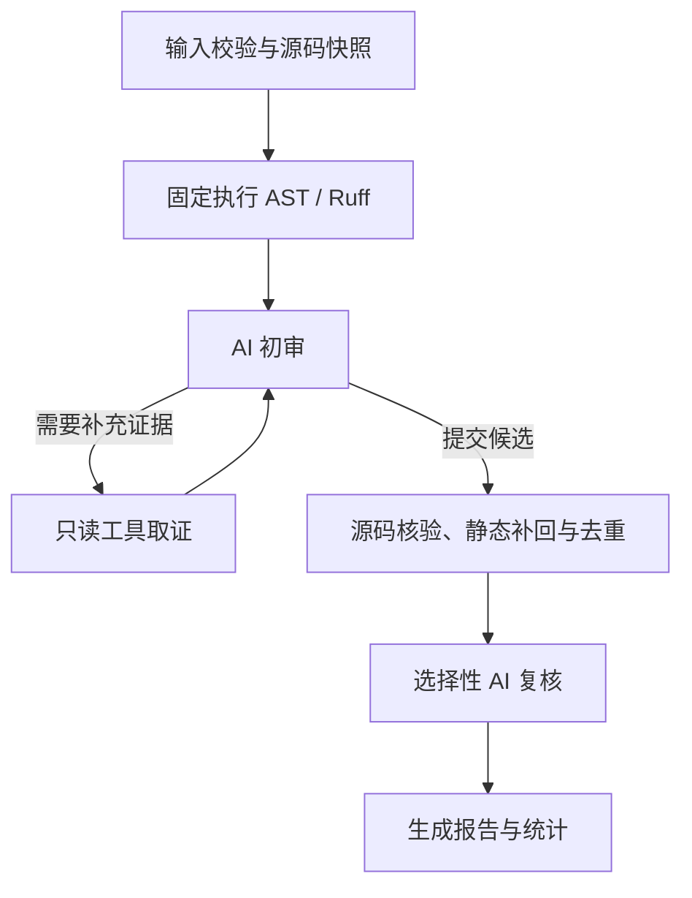

# TraceReview

项目仓库：[Fang-Xinyu/code-review-agent](https://github.com/Fang-Xinyu/code-review-agent)

TraceReview 是一个面向单个 Python 文件的代码审查 Agent。它先执行内置 AST 规则和 Ruff，再让模型结合完整源码与真实诊断生成候选；程序核对证据、补回静态诊断，最后对部分候选进行模型复核，输出 Markdown 或 JSON 报告。

应用展示名称为 TraceReview，项目名为 `code-review-agent`，Python 导入包名为 `review_agent`。架构、调用流程和模块职责见 [Design.md](Design.md)。

## 安装与启动

需要 Python 3.9+。以下命令在项目根目录执行，依赖中的 Streamlit 要求 1.50 及以上版本。

```bash
python3 -m venv .venv
source .venv/bin/activate
python -m pip install -r requirements.txt
python -m streamlit run app.py
```

默认访问 `http://localhost:8501`。未激活虚拟环境，或终端提示 `streamlit: command not found` 时，可直接运行：

```bash
.venv/bin/python -m streamlit run app.py
```

## 使用方法

### 网页

1. 在侧边栏填写 API Key，可修改 Base URL、模型名并测试连接。默认模型为 `deepseek-flash`。
2. 选择内置示例、上传 `.py` 文件或直接粘贴代码，在编辑区确认源码和文件名。
3. 填写审查重点，点击“开始审查”，查看阶段进度与最终报告。
4. 展开问题，阅读源码证据、触发条件、解释、建议及复核结论。
5. 围绕报告追问，或点击问题旁的“生成修复”；查看补丁并下载 Markdown / JSON 报告。

输入需为 UTF-8 Python 代码，同时满足 **最多 2000 行、100 KB（102400 字节）**。审查重点可以提供明确的功能约定，帮助模型判断实现是否符合预期。

网页配置来自侧边栏。CLI 读取环境变量；`.env.example` 提供配置示例，程序不自动加载 `.env`。审查源码会发送到配置的模型服务，API Key 不写入报告。

修改源码或文件名后，旧报告仍可查看和导出，追问与旧补丁预览会暂停，重新审查即可继续。补丁在内存中生成，用户查看后自行复制使用，不自动写回文件。聊天中包含“修复”“补丁”“fix”“patch”时进入补丁流程，请在当前请求中说明修复目标。

### 命令行

```bash
export DEEPSEEK_API_KEY='替换为你的 API Key'
python -m review_agent review examples/buggy_basic.py --focus "重点检查异常处理"
python -m review_agent review examples/demo_order_review.py --format markdown --output report.md
python -m review_agent review examples/demo_ai_inference.py --format json --output report.json
```

可通过 `DEEPSEEK_BASE_URL` 和 `DEEPSEEK_MODEL` 修改服务地址与模型。CLI 与网页共用审查引擎，支持单文件审查和导出；追问与补丁交互在网页中使用。

## 工作流程



AST 和 Ruff 提供规则诊断，模型结合完整源码分析控制流、边界、异常、资源、安全和注释约定。模型可以请求读取源码范围、符号上下文或已有诊断；程序执行这些只读工具后，将观察交给下一轮初审。

一次审查最多 8 次逻辑模型调用：初审最多 5 轮，前四轮每轮最多 5 次工具取证；其余额度用于格式修正与复核。模型可提前提交结果，最终报告最多保留 30 条问题。详细预算和失败分支见设计文档。

## 如何阅读报告

报告先按确认情况分组，再按 AST、Ruff、AI 来源展示。**严重度表示影响，确认情况表示证据支持程度。**

| 确认情况 | 含义 |
| --- | --- |
| 规则检查已确认 | 本次静态检查中不需要额外上下文的规则发现 |
| AI 复核通过 | 获得另一次模型复核支持的问题 |
| 需要人工确认 | 仍需上下文、复核不确定或静态规则信号被质疑的问题 |

前两类归入“已确认问题”。每条问题提供位置、连续源码证据、触发条件和修复建议；审查过程记录工具状态、核验记录、阶段耗时及逐次模型调用。追问和修复的调用统计在网页单独显示，不并入原审查报告。

项目采用单文件静态分析，不执行被审查代码或行为测试。模型复核与补丁校验提供审查依据，仍需结合项目需求判断；没有保留问题也不等于代码已证明正确。

## 示例、测试与项目结构

网页内置 `buggy_basic.py`、`buggy_context.py` 和 `clean_example.py`，分别用于观察典型规则问题、上下文风险和已有保护条件。`demo_order_review.py` 与 `demo_ai_inference.py` 提供业务场景，可上传到网页或通过 CLI 审查。

```bash
python -m pytest
```

测试使用假模型、模拟 HTTP 和真实 AST/Ruff，覆盖审查编排、证据核验、复核、补丁、报告导出及网页交互，无需真实 API Key。在线模型的审查效果需通过实际任务评估。

```text
code-review-agent/
├── app.py                 # Streamlit 网页入口
├── review_agent/          # 审查引擎、工具、模型协议、补丁和报告
├── examples/              # 审查示例
├── tests/                 # 自动化测试
├── scripts/               # 可选打包工具
├── .streamlit/config.toml
├── .env.example
├── pyproject.toml
├── requirements.txt
├── README.md
└── Design.md
```

`scripts/package_submission.py` 为可选 ZIP 打包工具，不参与安装或审查流程。

