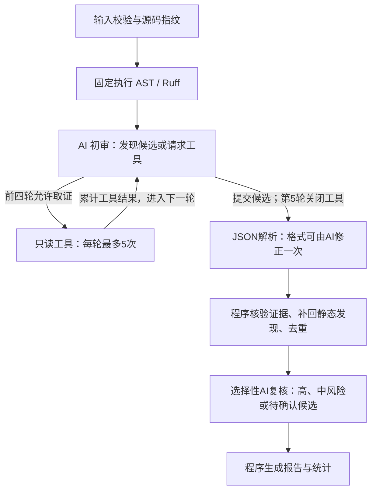

# TraceReview

项目仓库：[Fang-Xinyu/code-review-agent](https://github.com/Fang-Xinyu/code-review-agent)

仓库名、项目目录名和 Python 分发项目名统一为 `code-review-agent`；应用展示名称为 TraceReview，Python 导入包名为 `review_agent`。

TraceReview 是一个面向课程项目的 Python 代码审查 Agent，审查单个 `.py` 文件。程序先固定执行 AST/Ruff 检查，再由 LangGraph 编排 AI 初审、只读工具取证、源码证据校验和选择性独立复核，最后生成可导出的报告。

项目支持网页和命令行审查、报告追问、局部补丁及离线流程测试。完整处理流程、失败分支和模块职责见 [Design.md](Design.md)。

## 目录与安装

当前项目根目录为 `软件工程/code-review-agent/`。以下命令均在该目录执行；打包脚本会根据自身位置定位项目。

```text
code-review-agent/
├── app.py                 # Streamlit 网页入口
├── review_agent/          # 状态图、模型、工具、校验、补丁及报告
├── examples/              # 内置审查示例
├── tests/                 # 假模型及模拟 HTTP 的离线测试
├── scripts/               # 提交包生成脚本
├── .streamlit/config.toml # 上传组件的外围大小限制
├── .env.example           # 环境变量示例
├── requirements.txt
├── README.md
└── Design.md
```

需要 Python 3.9+。

```bash
python3 -m venv .venv
source .venv/bin/activate
python -m pip install -r requirements.txt
```

如果 VSCode 终端显示 `streamlit: command not found`，在项目目录直接使用虚拟环境中的 Python，不依赖终端当前的 PATH：

```bash
.venv/bin/python -m streamlit run app.py
```

默认打开 `http://localhost:8501`。若该端口已有服务，可在命令末尾增加 `--server.port 8502`，再打开 `http://localhost:8502`。

上传到 GitHub 时，将本目录内的 `app.py`、`review_agent/`、文档及其他项目文件放在仓库根目录，不再额外嵌套一层 `code-review-agent/`。虚拟环境、缓存和本地密钥文件不属于提交内容；`.env.example` 是可提交的配置示例。

## 网页使用

```bash
python -m streamlit run app.py
```

在侧边栏填写 DeepSeek API Key，可修改 Base URL 和模型名并测试连接。当前默认模型为 `deepseek-flash`。未填 Key 时审查按钮禁用；Key 只保存在当前会话和模型客户端中，不写入图状态、报告或日志。

1. 选择内置示例、上传文件或直接粘贴代码，再填写审查重点。
2. 点击“开始审查”，查看阶段进度；完整报告在审查结束后展示。
3. 阅读“已确认问题”“需要人工确认”和限制说明，展开源码证据与复核结论。
4. 根据报告追问，或明确描述修复目标来生成局部补丁。
5. 查看并复制通过校验的补丁，导出 Markdown/JSON 报告。

输入必须是 UTF-8 Python 代码，**同时满足最多 2000 行、100 KB（102400 字节）**。字节数按换行归一化前的 UTF-8 内容计算，行数按统一换行后的源码计算；上传、粘贴与 CLI 共用审查校验。上传组件的外围限制为 1 MB，应用会在载入编辑区前进一步拒绝超过 100 KB 的文件。

修改源码或文件名后，若与报告快照不同，仍可查看旧报告，但追问和旧补丁会禁用，需要重新审查。点击重新审查会清除旧报告、对话和补丁；新审查失败时显示错误，不把旧报告当作本次结果。补丁只在内存中生成，不自动写回文件。

## 命令行使用

```bash
export DEEPSEEK_API_KEY='...'
python -m review_agent review examples/buggy_basic.py --focus "重点检查异常处理"
python -m review_agent review examples/buggy_basic.py --format markdown --output report.md
python -m review_agent review examples/buggy_basic.py --format json --output report.json
```

也可通过 `DEEPSEEK_BASE_URL`、`DEEPSEEK_MODEL` 配置服务地址和模型。CLI 与网页复用同一个审查状态图；当前 CLI 提供审查与导出，追问和补丁交互位于网页中。

## 审查如何进行



初审用于发现问题，复核用于审查已有候选是否成立；复核采用同一配置模型的新请求和专门提示词，不能新增问题。工具由程序执行，不是模型内部自动运行。它们只重读当前源码、查询符号结构或筛选已有诊断，不执行用户代码，也不获得其他文件或外部业务事实。

## 调用次数与限制

| 项目 | 当前上限或规则 |
|---|---|
| 一次完整审查 | 最多 8 次逻辑模型调用，失败调用也计数 |
| AI 初审 | 最多 5 次，第 5 次关闭工具；可以提前提交候选 |
| 初审 JSON 修正 | 最多额外 1 次，计入总预算 |
| 选择性独立复核 | 最多 2 次，包含一次格式修正；无目标则跳过 |
| 补充工具 | 前四轮每轮最多 5 次，合计最多 20 次 |
| 工具输出 | 最终 JSON 最多 6000 字符，截断保留结构及标记 |
| 单次模型输出 | 最多 4096 tokens，不是字符数 |
| 服务请求 | 超时配置 40 秒；符合条件的失败最多重试 2 次 |
| 最终候选保留 | 程序合并后最多 30 条 |

模型调用、HTTP 请求和工具执行分别计数。例如一次模型调用先失败、重试成功，统计为 1 次模型调用、2 次 HTTP 请求。8 次逻辑调用最多可产生 24 次 HTTP 尝试；40 秒不是整次审查的总时限。

普通追问只调用模型一次，不取证、不复核、不自动更新报告，`answer` 必须是非空字符串。包含“修复”“补丁”“fix”“patch”的追问进入补丁流程：最多两次生成，每次先程序校验，通过后独立复核一次。成功通常需要两次模型调用；若生成或程序校验需修正，则最多三次。复核格式错误、不确定或不支持都会隐藏补丁，不再重新生成代码。

各次追问或修复操作独立受8次预算保护；网页单独显示最近一次交互的调用和服务请求数，不并入原审查报告统计。报告内“生成修复”按钮绑定对应问题，包含结构化目标；聊天修复依赖本条请求中的明确目标。

## 如何阅读审查报告

报告按确认情况分组，再按 AST、Ruff、AI 来源分组。**严重度表示影响，确认情况表示证据支持程度，两者独立。**

| 确认情况 | 含义 |
|---|---|
| 规则检查已确认 | 本次静态检查中不需要额外上下文的规则发现 |
| AI 复核通过 | 源码证据通过程序核验，并获得独立 AI 复核支持 |
| 需要人工确认 | 缺少上下文、尚未获复核支持、复核不确定或规则信号被 AI 质疑 |

前两类归入“已确认问题”。AI 复核通过不等于运行测试证明；规则成立也不自动证明严重业务后果。应结合每条问题的触发条件、连续源码证据、解释、建议及复核说明判断。

报告还提供工具状态、校验记录、已知限制、阶段用时及逐次模型调用信息。网页、Markdown及JSON均包含执行轨迹、阶段用时和调用记录；网页与Markdown用中文显示初审、格式修正、复核等阶段。JSON使用结构化 `events` 和 `usage`。报告还展示实际初审轮数、生成报告时的预算上限和初审结束原因。缺失的 token 统计显示为“不可用”，不能解释为零。当前JSON格式版本为1.1，新增预算及初审状态字段，数据模型仍可读取1.0报告，旧会话会显示统计兼容提示，建议重新审查以获得完整记录。

“没有发现问题”表示在本次输入、规则和预算下未保留问题，不代表代码已证明正确。工具截断、候选裁剪或复核失败时，应同时阅读限制和校验记录。审查报告不含后续追问、补丁的调用统计，也不是包含源码全文、全部工具观察和提示词的重放日志。

## 演示、测试与直接上传

建议依次审查 `buggy_basic.py`、`buggy_context.py`、`clean_example.py`，观察确定性规则、条件性风险以及已有保护条件，再演示追问、补丁和导出。

```bash
python -m pytest
```

未激活虚拟环境时，可用 `.venv/bin/python -m pytest`。自动化测试使用假模型和模拟HTTP，不依赖真实 API；包括模型适配层、HTTP重试、实际AST/Ruff、CLI导出、网页交互和错误分支。它们验证流程与边界，不证明在线AI的漏报率、误报率或更多轮次的效果。

提交时直接上传本目录内的项目文件到GitHub仓库根目录，无需生成压缩包。`scripts/package_submission.py` 保留为可选辅助工具，不参与安装、启动或审查流程。

## 能力边界

- 只处理单个文件，不支持整个仓库扫描、跨文件依赖分析或外部需求验证。
- 每轮初审仍发送完整源码并附加累计工具结果；单条工具限制不等于总上下文限制，100 KB 也不保证服务上下文足够。
- AST/Ruff 在相同源码、版本和配置下正常执行时是确定性检查；Ruff 失败会记录状态，不能当作无问题。
- Ruff 仅通过 stdin、`shell=False`、`--isolated --no-cache --select F,E9` 执行。
- 不导入或执行被审查源码，不运行用户测试；补丁通过语法、静态比较和 AI 复核不等于行为正确性证明。
- 符号调用位置按名称匹配，最多 20 处，不是精确调用图；资源与安全 AST 规则是有界启发式。
- 模型遵循提示词的检查方法，但程序未逐项验证分析覆盖；模型可用性、输出长度和 JSON 遵循程度会影响结果。
